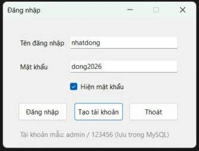
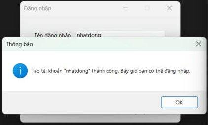
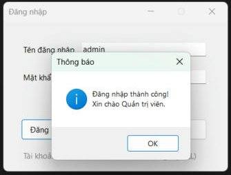

# Bài tập 5.1 – Login Form lưu trữ CSDL (nâng cấp Bài 4.1)

**Sinh viên:** Trần Nhật Đông – MSSV 24810320177 – Lớp D19QTANM1 – Lập trình .NET

## Nội dung nâng cấp
Bài 4.1 chỉ kiểm tra ô trống rồi báo "Đăng nhập thành công". Bài 5.1 lưu tài khoản trong **MySQL** và kiểm tra đăng nhập thật:

- Giữ nguyên yêu cầu 4.1: `txtUsername`, `txtPassword`, `chkShowPassword`, `btnLogin`, `btnExit`, `errorProvider`; Enter = Đăng nhập (`AcceptButton`), Esc = Thoát (`CancelButton`); không để trống bằng `ErrorProvider`.
- **CSDL `ql_dangnhap`**
  - `TaiKhoan`: tên đăng nhập, mật khẩu đã băm **SHA-256** (không lưu mật khẩu gốc), họ tên, ngày tạo.
  - `LichSuDangNhap`: ghi lại mọi lần đăng nhập thành công / thất bại.
- Truy vấn dùng **tham số** (`@u`, `@p`) để chống SQL Injection.
- Nút **Tạo tài khoản** thêm tài khoản mới vào CSDL (mật khẩu ≥ 6 ký tự, báo lỗi nếu trùng tên).
- Sai mật khẩu 3 lần thì chương trình tự đóng.
- Chương trình **tự tạo CSDL + bảng + tài khoản mẫu** khi chạy lần đầu.

Tài khoản mẫu: **admin / 123456**

## Hình ảnh minh họa

**1. Giao diện bình thường** – nhập tài khoản, tick "Hiện mật khẩu" để xem mật khẩu.

**2. Nhập lỗi** – để trống tên đăng nhập rồi bấm Đăng nhập, `ErrorProvider` báo lỗi cạnh ô nhập.

**3. Thêm tài khoản thành công** – bấm "Tạo tài khoản", tài khoản mới được lưu vào bảng `TaiKhoan` trong MySQL.

**4. Đăng nhập thành công** – mật khẩu được kiểm tra với dữ liệu trong CSDL.

## Cách chạy
1. Cài XAMPP, mở **XAMPP Control Panel** → **Start MySQL** (mặc định user `root`, không mật khẩu, cổng 3306).
2. Mở `BaiTap5_1_LoginForm.csproj` bằng Visual Studio 2022+ (.NET 10). NuGet tự tải gói `MySqlConnector`.
3. Nhấn **F5**. (Tùy chọn: chạy `database.sql` trong phpMyAdmin để tạo CSDL thủ công.)

Nếu MySQL có mật khẩu, sửa chuỗi kết nối trong `Database.cs`.
